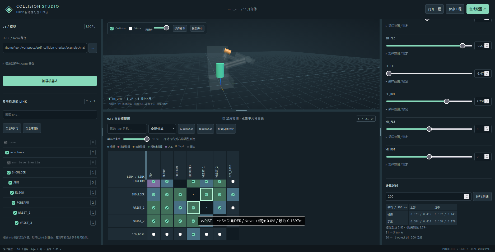
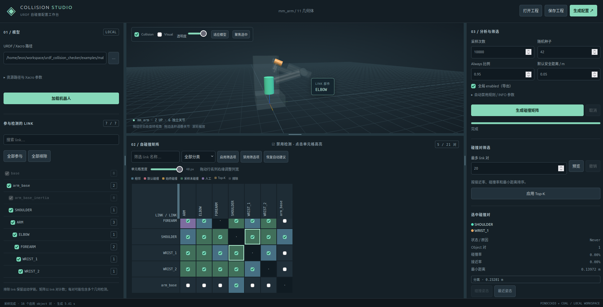

# Collision Studio

[简体中文](README.md) | [English](README.en.md)

A local URDF self-collision matrix editor powered by Pinocchio and Coal, with Three.js visualization. It reuses URDF adapters and joint dragging components from robot_viewer. ROS is not required.

## Screenshots

Collision matrix, pair highlighting, joint controls, and timing comparison:



Sampling, Top-K selection, pair details, and link name tooltips:



## Getting started

Requires Linux, an internet connection, and a browser with WebGL support. Set up the environment with one command:

```bash
./setup.sh
# Or start the application immediately after setup
./setup.sh --start
```

The script prepares Python 3.12, a pinned Node.js version, Python dependencies, and Xacro, then installs and builds the frontend using the lock files. If uv is unavailable, it downloads uv into the project's `.tools/` directory; this requires curl or wget. The virtual environment lives in `.venv/`. No sudo or shell profile changes are needed. The script can be called from any directory and run repeatedly. The first run requires internet access to download dependencies.

After setup, run `.venv/bin/urdf-collision-checker` and open http://127.0.0.1:8765 . Use `--port 9000` to select another port.

Use `./setup.sh --dev` to install development dependencies. Browser tests additionally require `.venv/bin/playwright install chromium`. System headers for the OCS2 C++ test are listed under Testing below. Regular setup removes unused development dependencies, so keep using `--dev` for development.

Manual installation, with Python 3.12, uv, and Node.js 22.12+ already installed (Node.js 24 recommended):

```bash
# From the project root
uv sync --extra test
npm --prefix frontend ci
npm --prefix frontend run build
uv run urdf-collision-checker
```

Open http://127.0.0.1:8765 . To change the port: `uv run urdf-collision-checker --port 9000`.

If Node.js is not installed system-wide, use the bundled development dependency:

```bash
uv sync --extra dev
export PATH="$PWD/.venv/bin:$PATH"
npm --prefix frontend ci
npm --prefix frontend run build
uv run urdf-collision-checker
```

Optional Xacro support: `uv sync --extra test --extra xacro`. For frontend development, start the backend first, then run `npm --prefix frontend run dev`. Vite proxies API and WebSocket requests automatically.

## Usage

1. Enter a local URDF path or click `…` to browse. You can also enter a directory containing a single candidate model. Resolve `package://` resources with a JSON mapping from package names to directories, such as `{"my_robot": "/home/me/robots/my_robot"}`.
2. Uncheck links in the left panel to exclude them from collision checking. Collision geometry is shown by default; switch to visual geometry or adjust opacity as needed. Drag the background to rotate the camera and drag a link to adjust its joint.
3. Configure joint sampling ranges and locks, sample count, Always threshold, and safety distance, then generate the matrix. Mimic joints follow their source joints. Colliding configurations remain in the sample set.
4. **A checked matrix cell means collision checking is disabled.** Click a cell to highlight both links. The details panel lets you replay a collision or closest configuration, override the pair's safety distance, or lock its selection.
5. Preview and apply Top-K selection. K counts link pairs; locked enabled pairs can exceed K. Selection can be undone. Never strictly means no actual collision was observed during sampling; these pairs are disabled by default even if they came close.
6. Benchmark collision and distance calculations for all eligible pairs versus the selected set. Measurements include kinematic updates and traverse all geometry pairs without early exit.
7. Export configuration files or save a project for later review. Projects reference the original model resources rather than copying the robot package.

Drag the left and right panel boundaries to adjust the central workspace width. Drag the horizontal divider between the 3D view and matrix to change their height ratio. A slider adjusts matrix cell width; drag the right edge of the row labels to resize that column. Large matrices scroll in both directions. Dividers support arrow keys, Shift for larger steps, and Home or double-click to reset. Layout preferences are stored in the browser.

Hover over visible collision or visual geometry to show its link name beside the pointer. The tooltip disappears when leaving the part, dragging, or switching models, and does not interfere with joint or camera controls.

Left-click empty space in the 3D view to clear pair highlighting and restore the display of all parts. Matrix checkboxes, collision settings, and the robot configuration are preserved. Dragging the background to adjust the camera does not clear the selection.

## Export and OCS2 integration

Files are written to the project's `config/` directory by default:

- `disabled_collisions.srdf`: the final set of disabled link pairs.
- `self_collision.info`: a native OCS2 `selfCollision` block. **Replace the existing block of the same name in task.info**; this file is not a complete task.info.
- `self_collision.yaml`: enabled link pairs, full geometry object mappings, the global `enabled` flag, `default_min_distance` (0.05 m by default), and per-pair distance overrides.

INFO preserves OCS2 field names and the `"link1, link2"` / `"0, 3"` list syntax. It includes both `collisionLinkPairs` and expanded `collisionObjectPairs`, with deduplication following Pinocchio pair handling. Tests read the generated output using the original OCS2 `loadStdVectorOfPair` C++ headers.

The original OCS2 configuration supports a single global `minimumDistance`. When per-pair overrides exist, the UI requires explicit confirmation before exporting INFO. INFO uses the global distance; YAML preserves the overrides. INFO parameters `mu` and `delta` can be edited in the advanced settings.

**Object indices depend on the consumer's model.** Use the same URDF collision geometry and construction order as OCS2. If the model, geometry, parser version, or construction process changes, revalidate indices against the exported object name and link mapping. Excluding links does not renumber objects. Format compatibility alone does not guarantee matching numeric indices across different models.

See [docs/implementation_plan.md](docs/implementation_plan.md) for the YAML schema and implementation plan (in Chinese). `collision_checker.export.read_enabled_yaml` provides a reference reader that expands enabled object pairs and resolves inherited safety distances.

## Testing

```bash
uv run --extra test pytest -q
npm --prefix frontend run build
```

The native OCS2 reader test requires `g++`, Boost, and Eigen3 headers. On Ubuntu, install `g++ libboost-dev libeigen3-dev`. If these dependencies are missing, that test is explicitly skipped; other tests can still run.

Browser end-to-end tests, with the server running:

```bash
uv sync --extra dev
uv run playwright install chromium
COLLISION_E2E_URL=http://127.0.0.1:8765 uv run pytest tests/test_browser.py tests/test_layout.py tests/test_view_interactions.py -q
```

`tests/fixtures/sample.urdf` is an MIT-licensed test model created for this project. It covers multiple collision geometries, fixed, continuous, prismatic, and mimic joints, plus intermediate links without geometry. The pre-existing workspace model in `examples/mabi_mobile/` is also used for practical model validation.

## Scope and limitations

The initial release targets tree-structured URDF models and local, single-user workflows. Environment collisions, closed-chain solving, and end-effector IK are outside its scope. A sampled Never classification does not prove that a pair cannot collide anywhere in the configuration space. Top-K is an empirical selection under a computational budget. The server listens on localhost only; models do not need to be uploaded or processed by an external service.

## Acknowledgments

Thank you to [fan-ziqi/robot_viewer](https://github.com/fan-ziqi/robot_viewer) for the reference implementation of URDF loading, 3D visualization, and joint dragging interactions. This project reuses its URDF adapters and joint dragging components while preserving their Apache-2.0 license. The analysis UI and Python backend are implemented in this repository.

See [NOTICE.md](frontend/src/vendor/robot_viewer/NOTICE.md) for the reused files, source revision, and local modifications, and [LICENSE](frontend/src/vendor/robot_viewer/LICENSE) for the original license. The OCS2 test headers retain their original BSD license.
