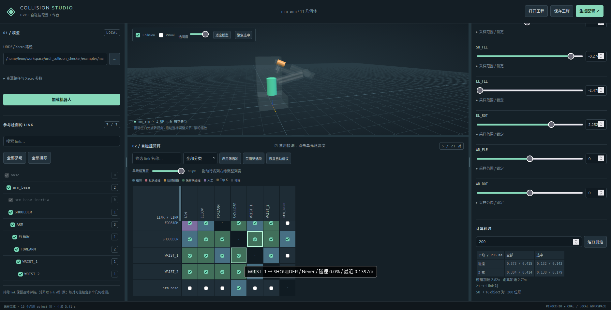
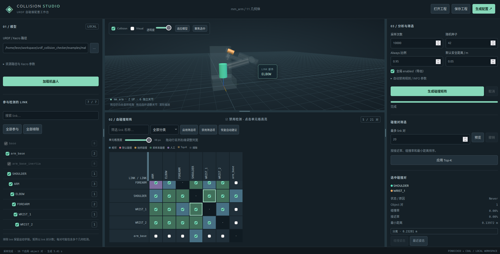

# Collision Studio

本地运行的 URDF 自碰撞矩阵编辑器：Pinocchio + Coal 计算，Three.js 显示，复用 robot_viewer 的 URDF 适配器和关节拖动组件。不依赖 ROS。

## 界面预览

碰撞矩阵、碰撞对高亮、关节调整及耗时对比：



采样分析、Top-K 筛选、碰撞对详情及鼠标悬停部件名称：



## 启动

要求 Linux、网络连接及支持 WebGL 的浏览器。一键准备环境：

```bash
./setup.sh
# 或配置完成后直接启动
./setup.sh --start
```

脚本自动准备 Python 3.12、固定版本的 Node.js、Python 依赖及 Xacro，并按锁文件安装、构建前端。没有 uv 时自动下载安装到项目 `.tools/`，需要 curl 或 wget。环境位于 `.venv/`，不需要 sudo，不修改 shell 配置，可从任意目录调用或重复执行。首次运行需要联网下载依赖。

配置完成后运行 `.venv/bin/urdf-collision-checker`，打开 http://127.0.0.1:8765 。传入 `--port 9000` 可自定义端口。

开发环境使用 `./setup.sh --dev`；浏览器测试需要额外执行 `.venv/bin/playwright install chromium`。OCS2 C++ 测试的系统头文件依赖见下方验证说明。普通配置会移除不需要的开发依赖，开发时请保留 `--dev`。

手动安装方式（已有 Python 3.12、uv 和 Node.js 22.12+，推荐 Node.js 24）：

```bash
# 在项目根目录
uv sync --extra test
npm --prefix frontend ci
npm --prefix frontend run build
uv run urdf-collision-checker
```

打开 http://127.0.0.1:8765 。自定义端口：`uv run urdf-collision-checker --port 9000`。

没有系统 Node.js 时可使用项目内开发依赖：

```bash
uv sync --extra dev
export PATH="$PWD/.venv/bin:$PATH"
npm --prefix frontend ci
npm --prefix frontend run build
uv run urdf-collision-checker
```

可选 Xacro：`uv sync --extra test --extra xacro`。开发界面：先启动后端，再运行 `npm --prefix frontend run dev`；Vite 自动代理 API 和 WebSocket。

## 使用

1. 填写本机 URDF 路径或点击 `…` 浏览。目录只有一个候选模型时可直接填写目录。`package://` 资源需填写包名到目录的 JSON 映射，例如 `{"my_robot": "/home/me/robots/my_robot"}`。
2. 左侧取消不参与计算的 link。默认显示 collision；可切换 visual、调整透明度。拖动空白处旋转相机，拖动连杆调整关节。
3. 设置关节采样范围/锁定、样本数、Always 阈值、安全距离，生成矩阵。mimic 自动跟随，采样不会排除碰撞位形。
4. **矩阵勾选表示禁用检测**。点击单元格高亮两个 link，详情中可回放碰撞/最近姿态、设置逐对安全距离或锁定。
5. 预览并应用 Top-K。K 按 link 对计数，锁定保留项可超过 K；可撤销。Never 严格表示采样未实际碰撞，即使接近也默认禁用。
6. 运行测速，对比全量/选中集合的碰撞判断和距离计算，包含运动学更新，不提前退出。
7. 生成配置，或保存工程以便之后继续审查。工程引用原模型，不复制模型包。

拖动左右侧栏边界可调整中央工作区宽度，拖动三维视图和矩阵之间的横向分隔条可调整上下比例。矩阵支持单元格宽度滑条及行名列右缘拖动，内容较多时双向滚动。分隔条支持方向键微调（Shift 加速）、Home 或双击复位，布局保存在当前浏览器中。

鼠标移到可见的 collision 或 visual 部件上，会自动在指针旁显示所属 link 名称；移出、拖动或切换模型时隐藏，不影响关节拖动和相机操作。
左键单击三维视图空白处可取消碰撞对高亮并恢复全部部件显示；矩阵勾选、检测配置和位形保持不变。拖动空白处调整视角不会清除选中。

## 导出与 OCS2

默认输出到项目 `config/`：

- `disabled_collisions.srdf`：最终禁用的 link 对。
- `self_collision.info`：原生 OCS2 `selfCollision` 配置块，**替换现有 task.info 中的同名块**；它不是完整 task.info。
- `self_collision.yaml`：最终启用 link 对、完整 object 映射、全局 `enabled`、`default_min_distance`（默认 0.05 m）及逐对覆盖。

INFO 保持 OCS2 的字段与 `"link1, link2"` / `"0, 3"` 列表格式，同时写入 `collisionLinkPairs` 和展开后的 `collisionObjectPairs`，按 Pinocchio 配对逻辑去重。测试用原 OCS2 `loadStdVectorOfPair` C++ 头文件读取实际输出。

OCS2 的原始配置只有一个 `minimumDistance`。存在逐对距离覆盖时，界面必须确认后才导出 INFO；INFO 使用全局距离，YAML 保留覆盖。INFO 的 `mu`、`delta` 可在高级设置中修改。

**object 索引取决于消费端模型。** 与 OCS2 使用相同 URDF collision 几何及构建顺序；若改变模型、几何、解析器版本或构建方式，必须对照导出的 object 名称/link 映射重新确认。排除 link 不会重编号。仅格式兼容不能保证不同模型中的数字索引一致。

YAML 结构和完整实现计划见 [docs/implementation_plan.md](docs/implementation_plan.md)。`collision_checker.export.read_enabled_yaml` 提供参考消费逻辑，展开有效 object 对并计算继承后的安全距离。

## 验证

```bash
uv run --extra test pytest -q
npm --prefix frontend run build
```

OCS2 原生读取测试需要 `g++`、Boost 与 Eigen3 头文件；Ubuntu 可安装 `g++ libboost-dev libeigen3-dev`。未提供这些依赖时该项明确跳过，其余测试正常运行。

浏览器端到端验证（先启动服务）：

```bash
uv sync --extra dev
uv run playwright install chromium
COLLISION_E2E_URL=http://127.0.0.1:8765 uv run pytest tests/test_browser.py tests/test_layout.py tests/test_view_interactions.py -q
```

`tests/fixtures/sample.urdf` 是本项目创建的 MIT 许可测试模型，覆盖多几何、fixed、continuous、prismatic、mimic 和无几何中间 link。`examples/mabi_mobile/` 为工作区已有模型，另用于实际模型验证。

## 边界

首版面向树形 URDF 和本地单人工作流，不提供环境碰撞、闭链或末端 IK。采样未发现碰撞不代表整个运动空间永不碰撞，Top-K 也是计算预算下的经验筛选。服务仅监听 localhost；无需上传模型或调用外部计算服务。

robot_viewer 复用代码、源版本与本地修改记录见 `frontend/src/vendor/robot_viewer/NOTICE.md`，OCS2 测试头文件保留原 BSD 许可证。
